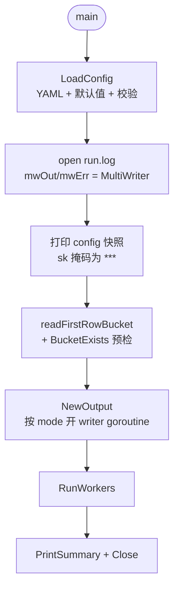
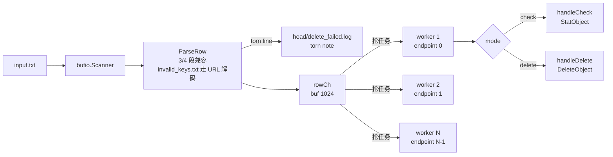
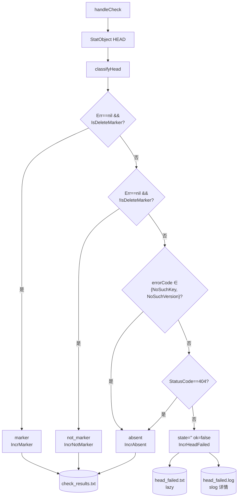
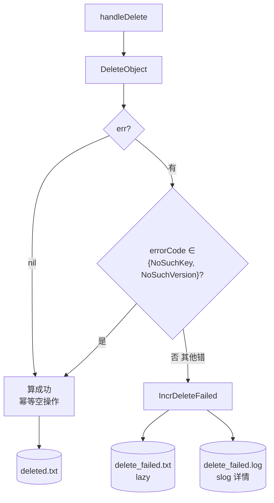

# AGENTS.md — delete_marker_cleanup_tool

本文件面向在本仓库工作的 AI 代理（和人类工程师），说明项目意图、模块边界、关键不变量与已知遗留项。改动前请先读完本文件对应章节。

## 1. 项目意图

本工具是 delete marker 清理链路的**第二步**：

1. `delete_marker_list_tool` 扫全桶列举出所有 delete marker → `delete_markers.txt`
2. **本工具**（`delete_marker_cleanup_tool`）消费该文件，按 `-mode` 做两种操作之一：
   - `check`：HEAD 每行版本，分类成 `marker` / `not_marker` / `absent` 三态
   - `delete`：按行里 version-id 调 `DeleteObject`，幂等删除

**典型工作流**：list → check 审计 → delete 删除 → check 复核全 absent。

设计文档：`../docs/superpowers/specs/2026-11-12-delete-marker-cleanup-tool-design.md`

## 2. 技术栈

- Go 1.27（`go.mod` module `delete_marker_cleanup_tool`）
- `github.com/aws/aws-sdk-go-v2/config` + `service/s3` v1.114.10、`smithy-go` v1.28.9（**Pin 不升级**——HEAD-on-delete-marker 的 405 + `x-amz-delete-marker: true` 行为按 aws-sdk-go-v2 v1.114.10 校准；升级需回归验证）
- `gopkg.in/yaml.v3`（配置）
- TLS：`scheme=https` 时 `InsecureSkipVerify=true`（对齐 lister / chunked_check_tool）

## 3. 模块布局

| 文件 | 职责 |
|---|---|
| `main.go` | flag 解析（`-c`/`-mode`/`-input`）、`run` 编排、run.log 打开（第一个 open）、配置快照打印（sk 掩码）、`readFirstRowBucket` 预检、summary 打印。无信号处理器 |
| `config.go` | `Config` 结构体 + `LoadConfig`（YAML，带默认值 + 校验 + 时间戳后缀重写）。无 `list_type` / `list_concurrency`，新增 `op_concurrency` |
| `s3client.go` | `S3Client`（s3.Client 包装）、`StatObject(ctx, bkt, key, vid) HeadResult`、`DeleteObject(ctx, bkt, key, vid) (statusCode, requestID, err)`、`BucketExists`。transport 调优对齐 lister |
| `classifier.go` | `classifyHead(HeadResult) (state, ok)`——HEAD 响应到三态的映射；`HeadResult.IsDeleteMarker` 已由 `headResultFromErr` 从 405 + `x-amz-delete-marker: true` 推断；StatusCode==404 兜底判 absent（AWS SDK 对 HEAD 404 返回 code="NotFound"） |
| `worker.go` | `Row{Bkt, Key, VersionID}`、`ParseRow(line, basename) (Row, bool)`（basename=`invalid_keys.txt` 时 URL 解码 key）、`RunWorkers` worker pool、`handleCheck` / `handleDelete` |
| `output.go` | `Output`：mode check 四个 writer goroutine（check_results / head_failed / head_failed.log / 日志）+ mode delete 三个（deleted / delete_failed / delete_failed.log）；惰性 failed 文件；3 秒定时 flush |
| `stats.go` | atomic.Int64 计数器 + `PrintSummary(w, mode)` 按模式切格式 |
| `progress.go` | `ProgressPrinter`：`MaybePrintCheck` / `MaybePrintDelete` 按模式打不同字段 |

## 4. 架构与流程

### 总体流程

### worker pool 数据流

### mode check — 三态分类

### mode delete — 幂等删除

**关键点**：`NoSuchKey`/`NoSuchVersion` 计入 `deleted.txt` 而非 `delete_failed.txt`——删除按 version-id 幂等，二次删同一版本返回 404 是预期路径。

## 5. 关键不变量（改动前必须守住）

1. **行分隔符 `\x1f`**：输入 `bkt\x1fkey\x1fversion_id`，check 结果 `bkt\x1fkey\x1fversion_id\x1f<state>`。**绝不**改回 `|`（对齐 lister；key 含 `|` 概率高于 `\x1f`）。

2. **`version_id` 字面量 `"null"` 是合法值**：S3 开版本控制前写入的旧对象返回字面量字符串 `"null"`。**原样透传**到 HEAD / DELETE，不要当空值。`ParseRow` 不做特殊处理。

3. **mode 三态判别不可放宽**（`classifier.go`）：
   - `r.Err == nil && r.IsDeleteMarker` → `marker`（`headResultFromErr` 已把 405 + `x-amz-delete-marker: true` 转成 `IsDeleteMarker=true, Err=nil`）
   - `r.Err == nil && !r.IsDeleteMarker` → `not_marker`
   - `errorCode(r.Err) ∈ {"NoSuchKey", "NoSuchVersion"}` → `absent`
   - `r.StatusCode == 404` → `absent`（兜底：AWS SDK 对 HEAD 404 返回 code="NotFound"，HEAD 无 body，SDK 用状态码推断）
   - 其他错误 → `(state="", ok=false)`，路由到 `head_failed.txt`
   - **不可**砍掉 `StatusCode==404` 兜底分支——AWS SDK 对 HEAD 404 不返回 `NoSuchVersion` code，仅按状态码推断，去掉会 100% head_failed

4. **mode delete 的 NoSuchVersion/NoSuchKey 算成功**：删除按 version-id 幂等，第二次删同一版本服务端返回 404；本工具把 `NoSuchKey` / `NoSuchVersion` 计入 `deleted.txt` 而非 `delete_failed.txt`。**不可**改成失败——会破坏"幂等空操作"语义。

5. **mode delete 不重新校验**：直接信任 input 行里的 version-id 调 `DeleteObject`。**不可**在 delete 前先 HEAD 校验——用户工作流已在前一轮 check 中审计过，重复 check 浪费一倍 HEAD。

6. **`*_failed.txt` 惰性创建**：文件不存在 = 无失败，文件存在 = 至少一次失败。**不可**在 `NewOutput` 时创建空文件。`output.go` 的 failed-writer lazy open + mutex 守护。

7. **无重试无断点无优雅退出**：失败靠把 `*_failed.txt` 当下一轮 input 重跑。**不可**加 retry / journal / signal handler（spec §非目标）。

8. **worker 按行号轮询绑 endpoint**：worker `i` 用 `endpoints[i % N]`，整轮生命周期不切。**不可**引入 NodePool / 节点隔离 / 重绑（spec §非目标）。

9. **`output_dir_timestamp` 同级后缀规则**：trim trailing `/` 或 `\`，append `_<YYYYMMDD_HHMMSS>`。**不是**子目录嵌套。对齐 lister/config.go。

10. **run.log 第一个 open**：先于任何输出文件。`mwOut = io.MultiWriter(os.Stdout, runLog)`，`mwErr = io.MultiWriter(os.Stderr, runLog)`。sk 在配置快照里掩码为 `***`。对齐 lister/main.go。

11. **`-mode` 必填无默认**：`main()` 校验 `-mode` 非空且 ∈ {`check`, `delete`}，否则 stderr + exit 2。**不可**给默认值——模式选择是正确性关键，按"校验类参数默认零值+强制显式配置"原则。

12. **`op_concurrency` 默认 8（未设时）**：与 lister 的 `list_concurrency` 行为对齐——0 视为"未设"→8，负数报错。**不可**把 0 也报错——破坏"未设走默认"的隐式契约。

13. **`\x1f`-in-key 输入兜底**：lister 把 key 含 `\x1f` 的 marker 路由到 `invalid_keys.txt`（key 经 `url.QueryEscape` 编码）。本工具按 `-input` 的 basename 判别：basename=`invalid_keys.txt` 时对 key 段做 `url.QueryUnescape` 用于 HEAD/DELETE 调用。**输出行重新 `url.QueryEscape` 编码 key**——解码后的 key 含 `\x1f`，直接写入会撕裂 3/4 段行格式。`Row.KeyEncoded` 字段记录来源，`Row.outputKey()` 决定输出形态。**不可**对所有输入都解码——只有 `invalid_keys.txt` 命名的文件才编码过。

14. **预检硬退出条件**：`readFirstRowBucket` 失败（空文件 / 首行格式错）或 `BucketExists` 传输错误 → 硬退出；`exists=false` → warning + 继续（多桶输入保护——只校验首行 bkt）。

## 6. 约束

- 单 `package main`，独立 `go.mod`，与 lister / chunked_check_tool 平级
- HTTP transport 调优对齐 lister：`MaxIdleConnsPerHost: 32`、`IdleConnTimeout: 90s`、`dial_timeout` 默认 10s 兜底黑洞 IP、optional `ResponseHeaderTimeout`
- `UsePathStyle: true`
- 无 `-concurrency` flag（并发从 config 读），无 `-dry-run` / `-confirm` flag
- 未知 YAML 字段被忽略——可复用 lister / chunked_check_tool 的 config.yaml
- 集成测试用 `//go:build integration` tag 隔离，env `MINIO_ENDPOINT` / `MINIO_AK` / `MINIO_SK` 三选一缺即 `t.Skip`

## 7. 遗留任务（已知未决/未来工作）

1. **key 含 `\n` 仍会撕裂行**：lister 同样不防护，S3 key 含换行极罕见。未来如需可加 `\n` 检测 + URL 编码路由（同 `\x1f` 路由模式）。

2. **同秒内连续启动两次**（`output_dir_timestamp: true`）会撞目录并发 append 撕裂尾部行：靠下游解析时丢弃格式非法行兜底。

3. **无优雅退出**：Ctrl-C / kill -9 丢尾部整行，run.log 里 summary 不会打出来。未来如需可加两段式 SIGINT handler + journal——但 spec 明确非目标。

4. **mode delete 不重新校验**：依赖 input 来自 lister 输出。若用户手动构造 input，可能删错版本。文档约束 + 用户工作流保证，不强制校验。

5. **HEAD-on-delete-marker 的 405 判别依赖 aws-sdk-go-v2 v1.114.10 行为**：AWS SDK 对 HEAD delete marker 返回 `*awshttp.ResponseError{StatusCode:405}` + `x-amz-delete-marker: true` 头，`headResultFromErr` 据此把 `IsDeleteMarker=true, Err=nil`。升级 aws-sdk-go-v2 需回归此分支——SDK 内部错误封装如改结构会断 IsDeleteMarker 推断。

## 8. 相关文档

- 设计文档：`../docs/superpowers/specs/2026-11-12-delete-marker-cleanup-tool-design.md`
- 实现计划：`../docs/superpowers/plans/2026-11-12-delete-marker-cleanup-tool.md`
- `delete_marker_list_tool` AGENTS.md（输入来源）：`../delete_marker_list_tool/AGENTS.md`
- chunked_check_tool AGENTS.md（约定参考）：`../chunked_check_tool/AGENTS.md`
