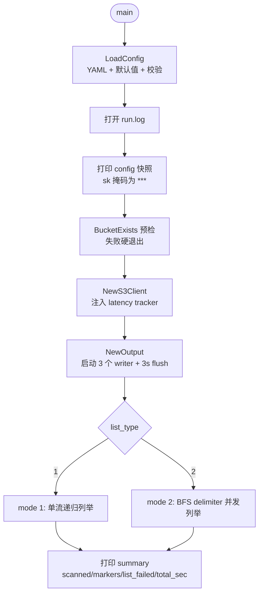
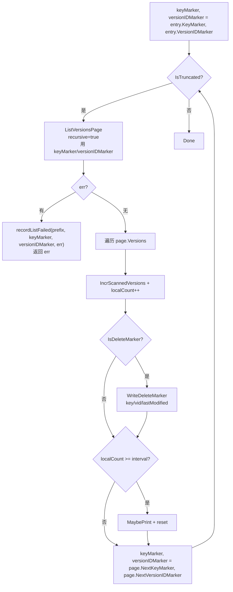
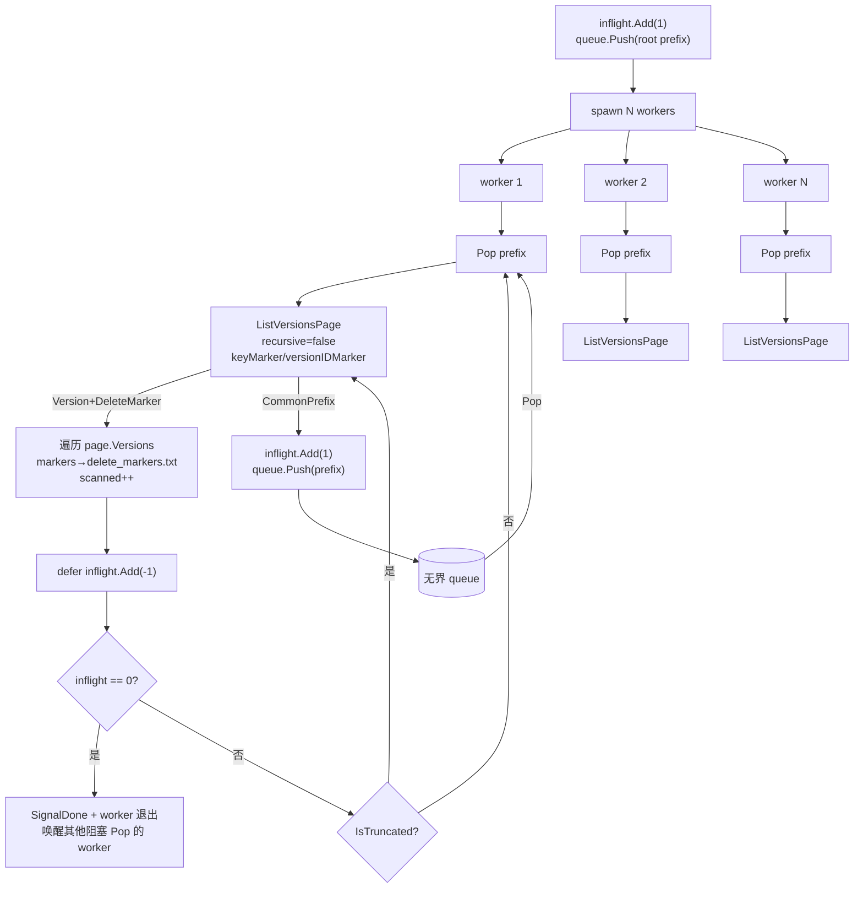

# AGENTS.md — delete_marker_list_tool

本文件面向在本仓库工作的 AI 代理（和人类工程师），说明项目意图、模块边界、关键不变量与已知遗留项。改动前请先读完本文件对应章节。

## 1. 项目意图

本工具是删除清理的**前置侦察**：扫全桶多版本列举，把所有 delete marker 落盘成 `delete_markers.txt`。下游工具（另行实现）读取该文件，逐条执行 `DeleteObject(bucket, key, VersionId)` 完成真正删除。

**本工具只读不删**。不做内容校验、不做备份、不做多段探测——这些是 chunked_check_tool 的职责。

设计文档：`../docs/superpowers/specs/2026-11-12-delete-marker-list-tool-design.md`

## 2. 技术栈

- Go 1.27（`go.mod` module `delete_marker_list_tool`）
- `github.com/aws/aws-sdk-go-v2/config` + `service/s3` v1.114.10、`smithy-go` v1.28.9（**Pin 不升级**——`ListObjectVersions` 把 `<Version>`/`<DeleteMarker>`/`<CommonPrefixes>` 解析到独立 slice，按 XML 标签区分；升级需回归验证）
- `gopkg.in/yaml.v3`（配置）
- TLS：`scheme=https` 时 `InsecureSkipVerify=true`（对齐 chunked_check_tool）

**用 `ListObjectVersions` 不用启发式区分**：AWS SDK 把 `<Version>`/`<DeleteMarker>`/`<CommonPrefixes>` 解析到独立 slice 字段，靠 XML 标签区分——key 以 `/` 结尾的真实版本不会被误判成 common prefix（曾经 minio-go 的 channel API 把三者合并到一个 channel、丢源标签，导致 `94-abc-0/` 这类 key 在 mode 2 漏统计）。

## 3. 模块布局

| 文件 | 职责 |
|---|---|
| `main.go` | flag 解析（`-c`/`-bkt`/`-prefix`）、`run` 编排、run.log 打开（第一个 open）、配置快照打印（sk 掩码）、BucketExists 预检、summary 打印。无信号处理器 |
| `config.go` | `Config` 结构体 + `LoadConfig`（YAML，带默认值 + 校验 + 时间戳后缀重写） |
| `s3client.go` | `S3Client`（s3.Client 包装）、`ListVersionsPage(ctx, bkt, prefix, recursive, keyMarker, versionIDMarker) (*VersionPage, error)`（page-at-a-time：每调一次返回一页 Version+DeleteMarker+CommonPrefixes）、`BucketExists`。transport 调优对齐 chunked_check_tool |
| `lister.go` | `Lister`：mode 1 单流 + mode 2 BFS 两种驱动；分页循环在 worker 内部（keyMarker/versionIDMarker 是局部变量，失败时即续传点）；不再有 `isCommonPrefix` 启发式（AWS SDK 按 XML 标签区分 Version/DeleteMarker/CommonPrefixes）；`recordListFailed` 从 `*awshttp.ResponseError` 提 StatusCode + reqID |
| `queue.go` | 无界前缀队列（slice + mutex + cond），ctx-aware Pop，`SignalDone` 终止。对齐 chunked_check_tool/queue.go 形态，砍掉 Drain（无优雅退出） |
| `output.go` | `Output`：三个 writer goroutine（delete_markers / invalid_keys / list_failed）+ slog listLogger；`\x1f` 行分隔符；key 含 `\x1f` 自动路由到 invalid_keys + URL 编码；list_failed.txt 惰性 open；3 秒定时 flush |
| `stats.go` | atomic.Int64 计数器 + `StatsSnapshot` + `PrintSummary` |
| `progress.go` | `ProgressPrinter`（per-worker 本地计数 + 阈值打印）+ `QueueSnapshot`（mode 2 队列/inflight 快照） |

## 4. 架构与流程

### 总体流程

### mode 1 — 单流递归

### mode 2 — BFS delimiter 并发

**终止不变量（Add-before-Push）**：入队新前缀必须先 `inflight.Add(1)` 再 `queue.Push`。违反会让 worker 提前看到 `inflight==0` → `SignalDone` → 漏扫子目录。

**终止由 worker 事件触发**：worker 处理完一个 entry（`defer inflight.Add(-1)` 已减计数）后检查 `inflight.Load() == 0`，归零时该 worker 调 `q.SignalDone()` 唤醒其他阻塞 Pop 的 worker 退出。归零时无在处理条目，不可能有并发 push（push 来自在处理条目发现 common prefix），故 SignalDone 不会误杀未处理条目。无轮询 goroutine。

## 5. 关键不变量（改动前必须守住）

1. **行分隔符 `\x1f`**：行格式 `bkt\x1fkey\x1fversion_id`。**绝不**改回 `|`——chunked_check_tool 用 `|`，但本工具因 key 含 `|` 会导致漏删（marker 永远删不掉），刻意换 `\x1f`。`output.go` 的 `rowSep` 常量不可改。

2. **`version_id` 字面量 `"null"` 是合法值**：S3 开版本控制之前写入的旧版本对象返回字面量字符串 `"null"` 作为 VersionId。下游删除工具必须原样透传，不要当空值。本工具原样写入结果文件，不做特殊处理。

3. **AWS SDK 按 XML 标签区分 Version/DeleteMarker/CommonPrefixes**：`ListObjectVersions` 输出三个独立 slice，**没有启发式**。`ListVersionsPage` 把 Version/DeleteMarker 摊平到 `VersionEntry{IsDeleteMarker: bool}`、把 CommonPrefixes 放到 `VersionPage.CommonPrefixes`。**不可**加任何"key 以 `/` 结尾即 common prefix"的启发式——曾经 minio-go 合并 channel 导致 `94-abc-0/` 这类 key 在 mode 2 漏统计。
   - null 版本对象的 VersionID 是 `"null"` 字符串（非空），按 AWS SDK 返回原样透传

4. **mode 2 BFS 终止不变量——Add-before-Push**：每入队一个新前缀**先** `inflight.Add(1)` **再** `queue.Push`。违反会导致 inflight 提前归零 → 提前终止 → 漏扫子目录。对齐 chunked_check_tool/AGENTS.md §4.7。

5. **`list_failed.txt` 惰性创建**：文件不存在 = 无失败，文件存在 = 至少一次失败，空行 = 空前缀失败。**不可**在 NewOutput 时创建空文件（会破坏"文件存在即有失败"契约）。`output.go` 的 `writeListFailedLine` 在首次调用时 lazy open。

6. **无重试无断点无优雅退出**：失败靠整轮重跑。**不可**加 retry/journal/signal handler（与 chunked_check_tool 不同；spec §9 非目标）。

7. **无 NodePool 无节点恢复**：mode 2 worker 用原子轮询绑 endpoint，失败即记 `list_failed` 继续。**不可**引入节点隔离/重绑/恢复探测（spec §9 非目标）。

8. **`output_dir_timestamp` 同级后缀规则**：trim trailing `/` 或 `\`，append `_<YYYYMMDD_HHMMSS>`。**不是**子目录嵌套（`./out/` → `./out_<stamp>` 而非 `./out/_<stamp>`）。对齐 chunked_check_tool/config.go:93-106。

9. **run.log 第一个 open**：先于任何输出文件。`mwOut = io.MultiWriter(os.Stdout, runLog)`，`mwErr = io.MultiWriter(os.Stderr, runLog)`。sk 在配置快照里掩码为 `***`。对齐 chunked_check_tool/main.go:102-110。

10. **`\x1f`-in-key 路由**：key 含 `\x1f` 的 marker 走 `invalid_keys.txt`，key 经 `url.QueryEscape` 编码。**不可**直接写入 `delete_markers.txt`（会撕裂行字段）。`output.go` 的 `WriteDeleteMarker` 自动检测 + 路由。

11. **aws-sdk-go-v2 v1.114.10 ListObjectVersions**：响应 `Versions` / `DeleteMarkers` / `CommonPrefixes` 三个独立 slice，按 XML 标签区分。`ListVersionsPage` 把 Version + DeleteMarker 摊平到 `VersionEntry`（IsDeleteMarker 区分），CommonPrefixes 放到 `VersionPage.CommonPrefixes`。升级 aws-sdk-go-v2 需重验三 slice 是否仍按 XML 标签区分（spec §4.1）。

12. **已知偏差——scanned_versions 在 mode 2 对"以 / 结尾的目录 key"少统计，不修**：自研 S3 有 quirk——`delimiter=/` 列举时以 / 结尾的 key（如 `97-abc-0/`）被折叠到 `<CommonPrefixes>`，但用 `prefix=97-abc-0/` + `delimiter=/` 再列举时**不返回 `97-abc-0/` 本身**作为 Version（目录标记 quirk）。mode 2 的 BFS re-list 踩在这个 quirk 上，目录 key 本身作为 Version（vid 通常是 `"null"`）被静默丢失，导致 `scanned_versions` 比 mode 1 少。
   - **delete_markers.txt 完整正确**——`<DeleteMarker>` 是独立 XML 标签，不走 CommonPrefix 路径，所有 delete marker 都会被列出。这是工具的真正产出，不受 quirk 影响。
   - **不修的原因**：scanned_versions 是诊断指标，不是产出。修复需要 CommonPrefix re-list 改用 recursive（无 delimiter），会失去 shard 内部多级细分（并发度下降）。诊断指标的 cosmetic 偏差不值得牺牲并发。
   - **`version_id == "null"` 不是判断标志**：`"null"` 是版本控制前旧对象的合法 VersionId（AWS 标准），不是目录标记标识。过滤 vid=null 会误伤所有版本控制前的旧对象，偏差更大。
   - **mode 1 无此问题**：recursive 列举不分 shard，目录 key 本身作为 Version 直接返回。

13. **`-retry <file>` 与 `-prefix` 互斥**：`-retry` 读文件每行一个 RetryEntry，初始 BFS 入队用该列表（去重保序，按 prefix+marker 三元组去重）。mode 1 + 多 entry 报错（`Lister.Run` 在 `list_type==1 && len(entries)>1` 时报错）；mode 1 + 单 entry retry 文件不报错——从该 entry 的 marker 续扫该 prefix。`-retry` 文件不存在 = 硬退出（`resolveEntries` 调 `readRetryEntries`，文件缺失在 BFS 启动前报出）。`-retry` 模式下 `list_failed.txt` 仍会记新失败，可多次 `-retry list_failed.txt` 续传；但 `output_dir_timestamp: true`（默认）时每次运行目录不同，retry 文件需指向上一轮的 `<output_dir>_<ts>/list_failed.txt`。

14. **`-retry` 是 next-marker 页级续传**：每行格式 `prefix\x1fkeyMarker\x1fversionIdMarker`——失败 prefix 已扫完的最后一页的 next-marker 被写入 `list_failed.txt`，retry 时从该 marker 起续扫（不重扫已扫页）。无 `\x1f` 行向后兼容旧格式（纯 prefix，从第一页扫）。`list_failed.txt` 行格式：`prefix\x1fkeyMarker\x1fversionIdMarker\n`，三个 marker 都空 = 从第一页扫（含 root prefix）。**prefix 含 `\x1f` 不支持**——`\x1f` 是字段分隔符，无法在 3-field 格式里无歧义表示（与 `delete_markers.txt` 用 `\x1f` 分隔 key 同理的限制；S3 key/prefix 极少含 `\x1f`）。`ListVersionsPage` 是 page-at-a-time：worker 分页循环里 `keyMarker`/`versionIDMarker` 是局部变量，失败时它们的值就是这次失败请求用的 marker = 续传点，直接 `recordListFailed(prefix, keyMarker, versionIDMarker, err)`——无 channel、无时序依赖、不可能丢 marker。

## 6. 约束

- 单 `package main`，独立 `go.mod`，与 chunked_check_tool / list_only 平级
- HTTP transport 调优对齐 chunked_check_tool：`MaxIdleConnsPerHost: 32`、`IdleConnTimeout: 90s`、`dial_timeout` 默认 10s 兜底黑洞 IP、optional `ResponseHeaderTimeout`
- `UsePathStyle: true`（ip:port 节点更安全，避免 DNS 子域）
- 无 `-resume` / `-nextmarker` / `-check-file` / `-list-file` / `-backup-file` flag
- `list_type` **必须显式配置**（1 或 2），不给默认值——模式选择是正确性关键，按"校验类参数默认零值+强制显式配置"原则不设默认（与 chunked_check_tool 不同，那里 list_type 默认 2）
- 未知 YAML 字段被忽略——可复用 chunked_check_tool 的 config.yaml

## 7. 遗留任务（已知未决/未来工作）

1. **key 含 `\n` 的 marker 仍会撕裂行**：chunked_check_tool 同样不防护，S3 key 含换行极罕见。未来如需可加 `\n` 检测 + URL 编码路由（同 `\x1f` 路由模式）。

2. **同秒内连续启动两次**（`output_dir_timestamp: true`）会撞目录并发 append 撕裂尾部行：靠下游解析时丢弃格式非法行兜底。如需严格保证可加"目录已存在即拒绝"——但需同时支持 `output_dir_timestamp: false` 的补齐追加语义，两者冲突。

3. **无优雅退出**：Ctrl-C / kill -9 丢尾部整行，run.log 里 summary 不会打出来。未来如需可加 chunked_check_tool 的两段式 SIGINT handler + journal——但 spec §9 明确非目标，加之前需重新评估。

4. **下游删除工具未实现**：需读 `delete_markers.txt` + `invalid_keys.txt`（后者 key 需 `url.QueryUnescape` 解码），逐条 `DeleteObject(bucket, key, VersionId)`。删除按 version-id 幂等——重复行无害。

5. **`queue.Pop` 空等时每次起临时 goroutine 桥接 ctx 到 cond**：`queue.go` 的 Pop 在队列空时，每次都 `make(chan struct{})` + 起一个 goroutine 监听 `ctx.Done()` 后广播 cond，`cond.Wait()` 醒来后 `close(stop)` 销毁。8 worker 突发间隙各自进 Pop 空等会反复起 goroutine。更优解是 queue 构造时起一个常驻 ctx-watcher goroutine，所有 Pop 共享——但稳态下队列持续有货（大桶），空等只在收尾，收益不抵改动风险，暂不修。

## 8. 相关文档

- 设计文档：`../docs/superpowers/specs/2026-11-12-delete-marker-list-tool-design.md`
- 实现计划：`../docs/superpowers/plans/2026-11-12-delete-marker-list-tool.md`
- chunked_check_tool AGENTS.md（约定参考）：`../chunked_check_tool/AGENTS.md`
